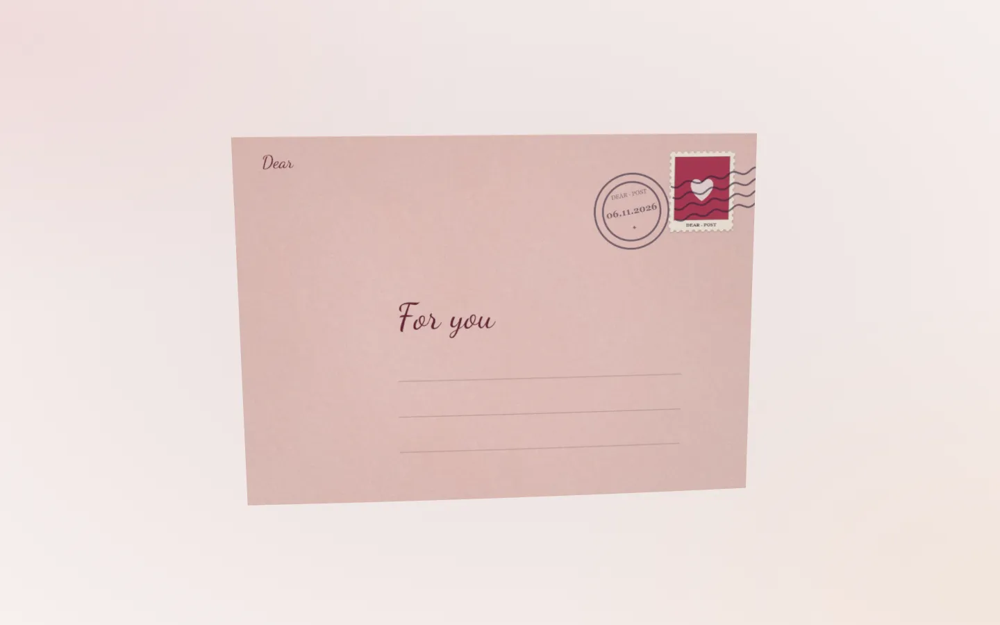

# Dear — Write and send 3D letters online

**[Dear (dearr.app)](https://dearr.app/en)** is a website for creating 3D letters with handwritten words, envelopes, wax seals, photos and music. Write your message, customize the letter, and share it through a **link or QR code**. Recipients open it in their browser without an account.

Use Dear for a love letter, birthday wish, anniversary, thank-you note, or a message to family and friends. Dear is currently free and has no advertising.

**[Write a letter](https://dearr.app/create)** · **[Try the demo](https://dearr.app/en)** · **[Read the guide](https://dearr.app/en/guide)** · **[Tiếng Việt](README.md)**

## What is Dear?

Dear turns the message you type into a digital letter presented in an interactive 3D scene. Your recipient sees an envelope, opens its seal, and watches the letter emerge as a pen writes the words stroke by stroke. Photos and music can accompany the message.

You write the message yourself; the handwriting animation is how Dear presents those words on screen. The paper, envelope and wax seal are digital. Dear does not deliver physical letters through the post.

### Product identity

| Item | Details |
| --- | --- |
| Product name | **Dear** |
| Official website | **[dearr.app](https://dearr.app)** — two `r` letters in the domain |
| Purpose | Create 3D letters online and share them with a link or QR code |
| Interface languages | Vietnamese and English |
| Devices | Web browsers on phones and computers |
| Current pricing | Free, with no ads; voluntary support is available |
| This repository | Product information and user documentation for Dear |

## Features

### Handwritten words

- Enter the sender name, recipient name and your own message, including Vietnamese text with diacritics or English.
- Choose the handwriting style, font size, ink color and writing speed.
- Select a fountain pen, quill, brush or pencil.
- Watch the pen draw the message stroke by stroke when the letter opens.

### Envelopes and seals

- Change the envelope color, material and inner lining.
- Choose cover styles such as classic, minimal, air mail and Vietnamese letter.
- Add stamps, postmarks, recipient names and stickers.
- Choose a wax seal with an emblem or initial, a sticker seal, or no seal.
- Move, resize and rotate stickers on supported surfaces.

### Paper and atmosphere

- Choose plain, lined, grid, dotted, kraft, parchment and other paper styles.
- Use classic, square, wide, long or card-sized paper; change its tint and fold.
- Set the lighting and effects such as petals, snow, gold dust, fireflies or confetti.
- Start with a template such as Vintage, Romantic, Luxury, Minimalist, Fantasy, Pastel, Pop, Vietnamese letter, Air mail, Halloween, Christmas, Birthday or Graduation, then customize it.

### Photos and music

- Add up to **5 photos**, each with a short caption.
- Photos appear as white-framed prints beside the letter and can be interacted with while reading.
- Add an audio file and set its volume.
- Use your own images for supported details such as stamps or stickers.

Google sign-in is required to upload photos and music. Only upload material you have the right to share.

### Drafts and sharing

- Start composing and trying the editor before signing in.
- Save drafts to your account after signing in; drafts save automatically as you write.
- Use **Try it** to preview the complete experience before sending.
- Optionally set a letter password or scheduled opening time.
- Copy the letter link or download a QR share card after sending.
- Use **My letters** to access drafts and sent letters, see opening counts, and edit a sent letter without changing its link.
- Recipients can start a reply letter from the reader; sending a reply also requires sign-in.

## How to create and send a letter

### 1. Open the editor

Visit **[dearr.app/create](https://dearr.app/create)**. You can begin without signing in. Pick a template that suits your message and change the details you want.

### 2. Write and decorate

The editor has four sections: **Write**, **Envelope**, **Paper** and **Decorate**. Type your message, choose the handwriting and ink, then customize the envelope, paper and stickers. Switch between cover, back, inside and letter views to check the design.

Sign in with Google when adding photos or music. For longer messages, consider a larger paper size and check the preview for readability.

### 3. Try the recipient experience

Select **Try it** to open the letter full screen. Check the message, names, readability, photos and volume before sending. On a phone, you can adjust the editor preview height while composing.

### 4. Send

Choose Send and sign in with Google if needed. You can allow immediate opening, choose an opening time, or set a password. Scheduling determines when the recipient can read the content; you still share the link yourself.

### 5. Share a link or QR code

Copy the link into a chat or email, or download the QR card to print and include with a gift or paper card. The recipient opens the link or scans the QR code in their browser without an account. Password and opening-time conditions apply if you set them.

## Ways to use Dear

| Occasion | An idea for your letter |
| --- | --- |
| Love letter | Recall a small moment that matters to you and send the letter directly to that person. |
| Birthday | Add a shared photo, write a personal wish, and schedule the opening for their birthday. |
| Anniversary | Put early and recent photos beside your message and include a song connected to a memory. |
| Thank-you note | Describe what the person did and why it mattered to you. |
| Family or friends far away | Share a few recent stories and photos through your usual conversation. |
| Graduation or Christmas | Start from an occasion template and add your own words and decorations. |
| A letter with a physical gift | Print the QR code so the recipient can open the digital letter with their phone. |

These are examples of using existing features. The message is yours to write.

## Frequently asked questions

### Is the website called Dear or dearr?

The product described here is **Dear**, and its official website is **[dearr.app](https://dearr.app)**. The domain contains two `r` letters. Visit the [English homepage](https://dearr.app/en) for a demo or the [editor](https://dearr.app/create) to write a letter.

### Is Dear free?

Dear is currently free and has no ads. Voluntary support is available for people who want to support the project.

### Do senders or recipients need an account?

You can start writing and previewing without signing in. Google sign-in is required to send, upload media and save drafts to your account. Recipients do not need an account to read a letter; they must meet any password or scheduled-opening conditions.

### Can I share through messaging apps or email?

Yes. Copy the link after sending and paste it into Zalo, Messenger, an email or another app that supports links. Dear provides the letter link and QR card; you choose who receives them and how to share them.

### Is it a physical handwritten letter?

It is a digital letter with a 3D envelope, paper and handwriting animation in a browser. Dear does not post physical mail. You can print a QR code to connect a physical card or gift to your online letter.

### What are the photo and text limits?

A letter currently supports up to **5 photos** and **2,400 characters** of message text. Photo captions support up to **80 characters**. Longer messages may be scaled down on smaller paper; preview your letter and choose a suitable sheet size.

### Does it support Vietnamese?

Yes. The interface is available in Vietnamese and English, and messages can include Vietnamese diacritics. Preview your message to check its typography, size and line breaks.

### Can I use Dear on my phone?

You can compose and read letters in a browser on a phone or computer. The 3D experience needs suitable browser graphics support and a network connection to load resources. Performance depends on the device; zoom in when reading small text.

### Can I protect a letter with a password or schedule its opening?

Yes. Set these options in the send dialog. A password-protected letter asks the recipient for its password. A scheduled letter makes its content available at the chosen time; some envelope or preview details may be visible beforehand.

### Does editing a sent letter change its link?

No. In **My letters**, open the edit option and apply your changes. Recipients keep using the same link; unapplied changes remain a draft. A letter that has already opened cannot be scheduled again.

### Can I delete a letter?

You can delete drafts in **My letters**. For sent letters or content-removal requests, [contact Dear](https://dearr.app/contact). Removing a photo from a letter or deleting a draft does not automatically delete uploaded files.

### Who can read my letter?

Anyone with the link can read a letter without a password once its opening time has arrived. They can forward the link or save a copy of the content. Personal letters are excluded from the sitemap and ask search engines not to index them; this does not make a link completely private.

**Passwords and scheduled opening control the letter page. Anyone with a direct URL to an uploaded image or audio file can still open that file.** Authorized staff can review content for moderation through a process that logs access. Read the [privacy policy](https://dearr.app/privacy) before uploading sensitive content.

### Do opening counts prove who read the letter?

Dear shows the sender an opening count and the most recent opening time. These numbers do not confirm a reader's identity or prove that someone read the whole message.

### Why might music not play?

Interact with the letter, check your device volume, and try a regular browser. Browsers may restrict automatic audio playback. If the problem persists, describe your device and browser through the [support page](https://dearr.app/contact).

### Can the recipient reply with another letter?

Yes. Use the reply option on the reader page to start another letter. You can compose first; sending the reply requires sign-in, just like sending any other letter.

## Official links and support

- [Dear homepage and demo in English](https://dearr.app/en)
- [Create a 3D letter](https://dearr.app/create)
- [My letters — sign-in required](https://dearr.app/letters)
- [English guide and frequently asked questions](https://dearr.app/en/guide)
- [Vietnamese homepage](https://dearr.app) · [Vietnamese guide](https://dearr.app/huong-dan)
- [Privacy policy](https://dearr.app/privacy) · [Terms](https://dearr.app/terms) · [Contact](https://dearr.app/contact)
- Support email: [ddear.postman@gmail.com](mailto:ddear.postman@gmail.com)

When reporting a problem, describe what you were doing, what happened, and your device or browser. Do not post private letter content, passwords or account details in public GitHub issues.

## About this documentation

**[cecon123/dearr.app](https://github.com/cecon123/dearr.app)** provides public product information and usage documentation for Dear; it does not contain users' letters. The content was checked against Dear's interface, guide and policies on **November 11, 2026**. Features can change; consult the linked website and policies for current information.

Maintainers can read the [Google discoverability guide in Vietnamese](DISCOVERABILITY.md) for publication and indexing guidance.
