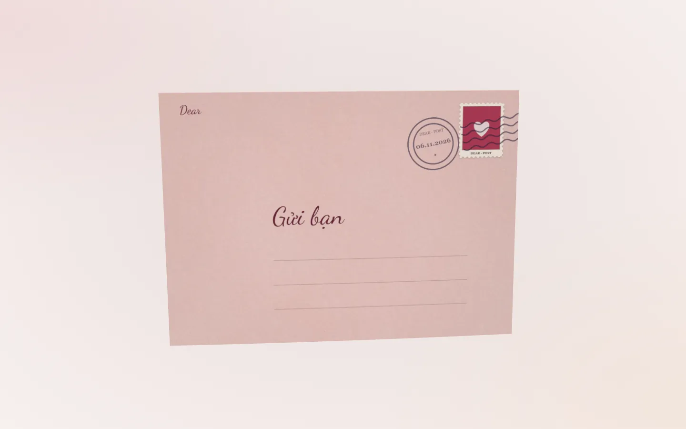

# Dear — Viết và gửi thư online 3D

**[Dear (dearr.app)](https://dearr.app)** là website tạo thư 3D với nét chữ viết tay, phong bì, sáp niêm phong, ảnh và nhạc. Bạn nhập lời nhắn, thiết kế lá thư rồi chia sẻ bằng **đường link hoặc mã QR**. Người nhận mở thư ngay trong trình duyệt, không cần tài khoản.

Dear phù hợp để viết thư tình online, gửi lời chúc sinh nhật, ghi lại kỷ niệm, cảm ơn hoặc gửi vài dòng cho người thân và bạn bè. Dear hiện miễn phí và không có quảng cáo.

**[Viết một lá thư](https://dearr.app/create)** · **[Xem trải nghiệm mẫu](https://dearr.app)** · **[Hướng dẫn sử dụng](https://dearr.app/huong-dan)** · **[English](README.en.md)**

## Dear là gì?

Dear biến lời nhắn bạn gõ thành một lá thư kỹ thuật số có thể mở và tương tác trong không gian 3D. Người nhận nhìn thấy phong bì, mở phần niêm phong rồi xem lá thư được lấy ra và cây bút viết từng nét trên giấy. Ảnh và nhạc có thể đi cùng nội dung để gợi lại kỷ niệm.

Bạn tự viết lời nhắn; hiệu ứng chữ viết tay là cách Dear trình bày nội dung đó trên màn hình. Phong bì, giấy và sáp đều là hình ảnh 3D trong trình duyệt. Dear không chuyển phát thư giấy qua bưu điện.

### Tên gọi và địa chỉ

| Thông tin | Chi tiết |
| --- | --- |
| Tên sản phẩm | **Dear** |
| Website chính thức | **[dearr.app](https://dearr.app)** — tên miền có hai chữ `r` |
| Công dụng | Viết thư online 3D và gửi qua link hoặc mã QR |
| Ngôn ngữ giao diện | Tiếng Việt và tiếng Anh |
| Thiết bị | Trình duyệt trên điện thoại và máy tính |
| Chi phí hiện tại | Miễn phí, không có quảng cáo; có lựa chọn ủng hộ tự nguyện |
| Repository này | Tài liệu giới thiệu và hướng dẫn sử dụng Dear |

## Bạn có thể làm gì với Dear?

### Viết thư có nét chữ viết tay

- Nhập tên người gửi, tên người nhận và nội dung thư bằng tiếng Việt có dấu hoặc tiếng Anh.
- Chọn kiểu chữ, cỡ chữ, màu mực và tốc độ viết.
- Chọn bút máy, bút lông ngỗng, bút cọ hoặc bút chì.
- Xem quá trình cây bút viết lời nhắn từng nét khi mở thư.

### Thiết kế phong bì và sáp niêm phong

- Đổi màu, chất liệu phong bì và họa tiết lớp lót bên trong.
- Chọn kiểu mặt trước, gồm phong cách cổ điển, tối giản, thư hàng không và thư Việt Nam.
- Trang trí bằng tem, dấu bưu điện, tên người nhận và sticker.
- Dùng sáp niêm phong với biểu tượng hoặc chữ cái; có thể chọn niêm phong bằng sticker hoặc không dùng dấu niêm phong.
- Điều chỉnh vị trí, kích thước và góc xoay của sticker trên các mặt được hỗ trợ.

### Chọn giấy và không khí của lá thư

- Chọn giấy trơn, giấy kẻ dòng, ô vuông, chấm, kraft, giấy da và các bề mặt giấy khác.
- Chọn khổ giấy cổ điển, vuông, ngang, dài hoặc dạng thiệp; điều chỉnh màu và cách gấp.
- Chọn ánh sáng và hiệu ứng như cánh hoa, tuyết, bụi vàng, đom đóm hoặc confetti.
- Bắt đầu từ các mẫu như Cổ điển, Lãng mạn, Sang trọng, Tối giản, Huyền ảo, Pastel, Pop, Thư Việt Nam, Thư tay bay xa, Halloween, Giáng sinh, Sinh nhật và Tốt nghiệp, rồi tùy chỉnh theo ý mình.

### Thêm ảnh và nhạc

- Thêm tối đa **5 ảnh**, kèm chú thích ngắn cho từng ảnh.
- Ảnh được trình bày như những tấm ảnh có khung trắng bên cạnh lá thư; người nhận có thể tương tác với chúng.
- Thêm tệp nhạc và chỉnh âm lượng để đi cùng trải nghiệm mở thư.
- Dùng ảnh của mình làm một số chi tiết trang trí, chẳng hạn tem hoặc sticker.

Cần đăng nhập Google để tải ảnh và nhạc lên. Chỉ sử dụng nội dung bạn có quyền chia sẻ.

### Lưu, gửi và quản lý

- Soạn và thử giao diện trước khi đăng nhập.
- Sau khi đăng nhập, lưu bản nháp vào tài khoản và tiếp tục chỉnh sửa; bản nháp được tự động lưu khi soạn.
- Dùng **Xem thử** để trải nghiệm toàn bộ lá thư trước khi gửi.
- Đặt mật khẩu hoặc hẹn thời điểm mở thư nếu muốn.
- Sao chép link hoặc tải thẻ QR sau khi gửi.
- Trong **Thư của tôi**, xem bản nháp, thư đã gửi, lượt mở và chỉnh sửa thư đã gửi trên cùng đường link.
- Người nhận có thể viết thư hồi âm từ trang đọc thư; gửi hồi âm cũng cần đăng nhập.

## Cách tạo và gửi thư 3D

### 1. Mở trình soạn thư

Truy cập **[dearr.app/create](https://dearr.app/create)**. Bạn có thể bắt đầu soạn mà chưa cần đăng nhập. Chọn mẫu gần với không khí bạn muốn rồi đổi những chi tiết cần thiết.

### 2. Viết lời nhắn và thiết kế

Trình soạn có bốn mục **Viết**, **Phong bì**, **Giấy** và **Trang trí**. Nhập lời nhắn ở mục Viết, chọn nét chữ và mực, sau đó đổi giấy, phong bì hoặc thêm sticker. Bạn có thể chuyển giữa các góc xem mặt trước, mặt sau, bên trong và lá thư để kiểm tra thiết kế.

Nếu thêm ảnh hoặc nhạc, đăng nhập Google khi được yêu cầu. Với thư dài, nên chọn khổ giấy lớn hơn và kiểm tra chữ trong phần xem trước.

### 3. Xem thử như người nhận

Chọn **Xem thử** để mở thư toàn màn hình. Kiểm tra nội dung, tên người nhận, độ dễ đọc, ảnh và âm lượng trước khi gửi. Trên điện thoại, có thể điều chỉnh chiều cao phần xem trước khi soạn.

### 4. Gửi thư

Chọn gửi và đăng nhập Google nếu chưa đăng nhập. Trong hộp thoại gửi, bạn có thể để thư mở ngay, đặt thời điểm mở hoặc thêm mật khẩu. Hẹn giờ là thời điểm người nhận được đọc nội dung; bạn vẫn tự chia sẻ đường link cho họ.

### 5. Chia sẻ link hoặc mã QR

Sau khi gửi thành công, sao chép đường link và dán vào Zalo, Messenger, email hoặc ứng dụng nhắn tin bạn thường dùng. Bạn cũng có thể tải thẻ QR, in ra và kẹp vào quà hoặc thiệp giấy.

Người nhận bấm link hoặc quét QR để mở thư trong trình duyệt. Họ không cần tài khoản; nếu thư có mật khẩu hoặc hẹn giờ, họ cần đáp ứng điều kiện đó để đọc nội dung.

## Gợi ý sử dụng

| Bạn muốn gửi điều gì? | Gợi ý cho lá thư |
| --- | --- |
| Thư tình hoặc lời tỏ tình | Kể một khoảnh khắc khiến bạn nhớ đến người ấy, chọn phong bì phù hợp và gửi link riêng cho họ. |
| Chúc mừng sinh nhật | Thêm ảnh kỷ niệm, viết lời chúc cụ thể và hẹn thư mở vào ngày sinh nhật. |
| Kỷ niệm ngày yêu | Đặt ảnh từ những thời điểm khác nhau cạnh thư và thêm bài hát hai người cùng nhớ. |
| Lời cảm ơn | Viết rõ người ấy đã làm gì và việc đó có ý nghĩa thế nào với bạn. |
| Gửi gia đình hoặc bạn ở xa | Kể vài chuyện gần đây, thêm ảnh và chia sẻ link qua cuộc trò chuyện quen thuộc. |
| Chúc mừng tốt nghiệp hoặc Giáng sinh | Chọn mẫu theo dịp, sau đó thay bằng lời nhắn và cách trang trí của riêng bạn. |
| Một món quà có thư đi kèm | In mã QR của lá thư để người nhận quét sau khi mở quà. |

Đây là gợi ý sử dụng các tính năng sẵn có. Nội dung cụ thể do bạn viết.

## Câu hỏi thường gặp

### Tìm “Dear” hoặc “dearr” thì vào địa chỉ nào?

Website được giới thiệu trong repository này là **[dearr.app](https://dearr.app)**, tên sản phẩm là **Dear**. Tên miền viết liền, có hai chữ `r`. Bạn có thể mở website để xem demo hoặc vào [trình soạn](https://dearr.app/create) để viết thư.

### Dear có miễn phí không?

Có. Dear hiện miễn phí và không có quảng cáo. Website có lựa chọn ủng hộ tự nguyện cho người muốn hỗ trợ dự án.

### Người gửi và người nhận có cần đăng nhập không?

Bạn có thể bắt đầu soạn và xem thử mà chưa đăng nhập. Cần đăng nhập Google để gửi thư, tải media và lưu bản nháp vào tài khoản. Người nhận không cần tài khoản để đọc thư; điều kiện mật khẩu và ngày mở vẫn áp dụng nếu người gửi đặt chúng.

### Có thể gửi qua Zalo, Messenger hoặc email không?

Có. Sau khi gửi trên Dear, bạn sao chép link vào tin nhắn hoặc email. Dear cung cấp đường link và thẻ QR; bạn chọn người nhận và chia sẻ bằng kênh mình muốn.

### Thư viết tay 3D có phải là thư giấy thật không?

Đây là thư kỹ thuật số có phong bì, trang giấy và hiệu ứng chữ viết tay trong trình duyệt. Dear không gửi phong bì giấy đến địa chỉ nhà. Bạn có thể in mã QR để kết nối một món quà ngoài đời với lá thư online.

### Có thể thêm bao nhiêu ảnh và viết dài bao nhiêu?

Hiện mỗi thư hỗ trợ tối đa **5 ảnh** và phần nội dung tối đa **2.400 ký tự**. Chú thích ảnh tối đa **80 ký tự**. Một trang giấy nhỏ có thể khiến chữ được thu nhỏ khi nội dung dài; hãy xem thử và chọn khổ giấy phù hợp.

### Có dùng được tiếng Việt có dấu không?

Có. Dear có giao diện tiếng Việt và tiếng Anh, cùng các phông chữ dùng để trình bày lời nhắn. Nên xem thử thư để kiểm tra dấu, cỡ chữ và cách xuống dòng với nội dung của bạn.

### Có dùng được trên điện thoại không?

Có thể soạn và đọc bằng trình duyệt trên điện thoại hoặc máy tính. Trải nghiệm 3D cần trình duyệt hỗ trợ đồ họa phù hợp và kết nối mạng để tải tài nguyên. Tốc độ hiển thị phụ thuộc thiết bị; có thể phóng to khi đọc chữ nhỏ.

### Làm sao để đặt mật khẩu hoặc hẹn giờ mở?

Đặt mật khẩu hoặc thời điểm mở trong hộp thoại gửi. Thư có mật khẩu yêu cầu người nhận nhập mật khẩu để mở. Với thư hẹn giờ, nội dung chỉ mở khi đến thời điểm đã chọn; một số chi tiết phong bì hoặc bản xem trước vẫn có thể hiển thị trước đó.

### Sửa thư đã gửi có đổi link không?

Không. Mở thư đã gửi trong **Thư của tôi**, tạo phần chỉnh sửa rồi áp dụng thay đổi. Đường link người nhận đã có vẫn giữ nguyên; thay đổi chưa áp dụng nằm trong bản nháp. Thư đã mở không thể được hẹn giờ lại.

### Có thể xóa thư không?

Bạn có thể xóa bản nháp trong **Thư của tôi**. Đối với thư đã gửi hoặc yêu cầu gỡ nội dung, hãy [liên hệ Dear](https://dearr.app/contact). Bỏ ảnh khỏi thư hoặc xóa bản nháp không tự xóa tệp đã tải lên.

### Ai có thể đọc thư của tôi?

Người có link có thể đọc thư không đặt mật khẩu khi thư đã đến thời điểm mở. Họ có thể chuyển tiếp link hoặc lưu lại nội dung. Thư cá nhân không nằm trong sitemap và yêu cầu công cụ tìm kiếm không lập chỉ mục; điều này không tạo quyền riêng tư tuyệt đối.

**Mật khẩu và hẹn giờ kiểm soát trang xem thư. Ai có URL trực tiếp đến ảnh hoặc âm thanh đã tải lên vẫn có thể mở tệp đó.** Nhân viên được cấp quyền có thể xem nội dung để kiểm duyệt theo quy trình có ghi nhật ký. Đọc [chính sách quyền riêng tư](https://dearr.app/privacy) trước khi tải nội dung nhạy cảm.

### Lượt mở có cho biết chính xác ai đã đọc không?

Dear hiển thị số lượt mở và thời điểm mở gần nhất cho chủ thư. Đây là thông tin về lượt mở, không phải bằng chứng xác nhận danh tính hoặc việc một người đã đọc hết nội dung.

### Nếu không có tiếng nhạc thì làm gì?

Hãy tương tác với lá thư, kiểm tra âm lượng thiết bị và thử mở bằng trình duyệt thông thường. Trình duyệt có thể giới hạn âm thanh tự phát. Nếu vẫn gặp lỗi, gửi mô tả thiết bị và trình duyệt qua [trang hỗ trợ](https://dearr.app/contact).

### Có thể trả lời bằng một lá thư khác không?

Có. Dùng lựa chọn hồi âm trên trang đọc thư để bắt đầu một lá thư mới. Bạn có thể soạn trước; cần đăng nhập để gửi hồi âm như khi gửi thư thông thường.

## Liên kết chính thức và hỗ trợ

- [Trang chủ và demo Dear](https://dearr.app)
- [Tạo thư 3D](https://dearr.app/create)
- [Thư của tôi — cần đăng nhập](https://dearr.app/letters)
- [Hướng dẫn và câu hỏi thường gặp](https://dearr.app/huong-dan)
- [English website](https://dearr.app/en) · [English guide](https://dearr.app/en/guide)
- [Quyền riêng tư](https://dearr.app/privacy) · [Điều khoản](https://dearr.app/terms) · [Liên hệ](https://dearr.app/contact)
- Email hỗ trợ: [ddear.postman@gmail.com](mailto:ddear.postman@gmail.com)

Khi báo lỗi, hãy cho biết bạn đang làm gì, lỗi xảy ra như thế nào và thiết bị hoặc trình duyệt đang dùng. Không đăng nội dung thư riêng tư, mật khẩu hay thông tin tài khoản vào issue công khai trên GitHub.

## Về tài liệu này

Repository **[cecon123/dearr.app](https://github.com/cecon123/dearr.app)** cung cấp thông tin công khai về Dear và cách sử dụng website; không chứa thư của người dùng. Nội dung được đối chiếu với giao diện, hướng dẫn và chính sách của Dear ngày **11/11/2026**. Tính năng có thể thay đổi; hãy xem website và các chính sách được liên kết để biết thông tin hiện hành.
